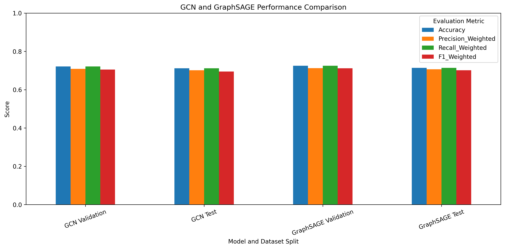
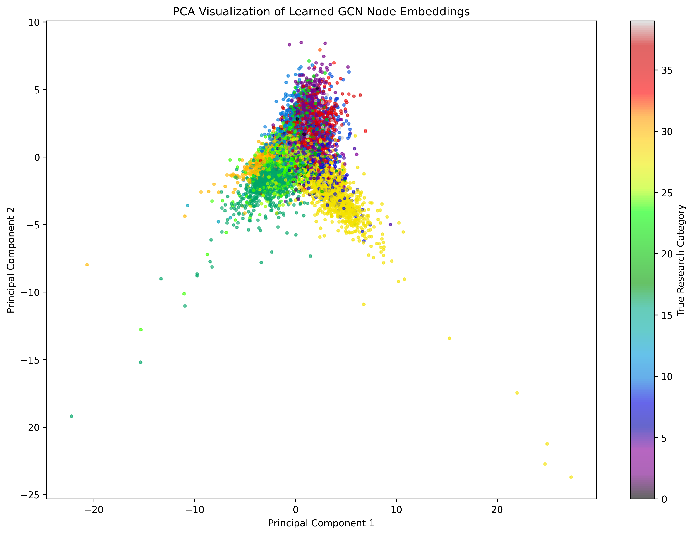

# Node Classification on OGBN-Arxiv Using Graph Neural Networks

A comparative study of **Graph Convolutional Network (GCN)** and **GraphSAGE** architectures for predicting the subject area of research papers in the OGBN-Arxiv citation network, implemented with PyTorch and PyTorch Geometric. The project covers the full workflow: graph analysis, data preparation, model development, hyperparameter optimisation, evaluation, explainability, and an interactive Streamlit dashboard.


---

## 1. Dataset

The project uses [`ogbn-arxiv`](https://ogb.stanford.edu/docs/nodeprop/#ogbn-arxiv) from the Open Graph Benchmark (OGB). Each node is an arXiv paper and each directed edge is a citation.

| Property | Value |
|---|---|
| Nodes (papers) | 169,343 |
| Directed edges (citations) | 1,166,243 |
| Edges after symmetrisation (message passing) | 2,315,598 |
| Node features | 128 (averaged word embeddings of title and abstract) |
| Target classes | 40 (arXiv subject areas) |
| Training / Validation / Test nodes | 90,941 / 29,799 / 48,603 |
| Graph density | 4.07 × 10⁻⁵ |

The dataset is downloaded automatically by the OGB library at run time and is therefore **not** included in this repository.

---

## 2. Methodology

1. **Graph analysis:** class distribution, in-degree and out-degree distributions, feature distribution, and graph density.
2. **Data preparation:** conversion to an undirected graph for message passing and verification of split integrity.
3. **Model development:** a 3-layer GCN and a 3-layer GraphSAGE, each with ReLU activations and dropout.
4. **Training:** Adam optimiser, cross-entropy loss, weight decay of 5 × 10⁻⁴, a maximum of 200 epochs, and early stopping with a patience of 30. Model selection is based on validation accuracy.
5. **Hyperparameter optimisation:** three configurations per architecture, varying hidden dimension, depth, dropout, and learning rate.
6. **Evaluation:** accuracy, weighted and macro precision, recall, and F1-score, together with normalised confusion matrices and per-class reports.
7. **Explainability:** PCA projection of learned node embeddings, neighbourhood influence analysis, and an edge-ablation experiment.

### Selected Configuration

| Parameter | GCN | GraphSAGE |
|---|---|---|
| Hidden channels | 128 | 128 |
| Number of layers | 3 | 3 |
| Dropout | 0.5 | 0.5 |
| Learning rate | 0.005 | 0.005 |

---

## 3. Results

| Model | Validation Accuracy | Test Accuracy | Test Weighted F1 | Test Macro F1 |
|---|---|---|---|---|
| GCN | 72.13% | 71.14% | 0.695 | 0.483 |
| GraphSAGE | **72.48%** | **71.42%** | **0.702** | **0.489** |

GraphSAGE marginally outperformed GCN on every reported metric. The gap between weighted and macro F1 indicates that performance is uneven across classes: frequent subject areas are predicted reliably, whereas minority classes remain considerably harder.



### Explainability Example

For node 160484 (true class 16), the model predicted the correct class with a confidence of 0.99999. Of its 157 neighbours, 98.7% share the same class. After removing its edges, the model still predicted class 16 with a confidence of 0.9989, a change of only 0.0011. This suggests that the prediction for this node is supported by its own features as well as by its neighbourhood.



---

## 4. Repository Structure

```
.
├── dashboard/                  # Streamlit dashboard (self-contained)
│   ├── app.py
│   ├── predictions.csv         # Per-node predictions for both models
│   ├── graph_stats.json
│   └── *.png, *.csv            # Figures and metrics displayed in the dashboard
├── models/
│   ├── gcn_best.pt             # Best GCN checkpoint
│   ├── graphsage_best.pt       # Best GraphSAGE checkpoint
│   └── model_config.json       # Selected hyperparameters and training settings
├── notebook/
│   └── OGBN_Arxiv_Graph_Neural_Network.ipynb
├── results/                    # Figures and evaluation tables
├── source_code/
│   └── ogbn_arxiv_graph_neural_network.py   # Script export of the notebook
├── data/                       # OGB dataset is downloaded here (git-ignored)
├── requirements.txt
└── README.md
```

---

## 5. Getting Started

### Installation

```bash
git clone https://github.com/dewmiabeykoon/OGBN-Arxiv-Graph-Neural-Network.git
python -m venv venv
source venv/bin/activate        # On Windows: venv\Scripts\activate
pip install -r requirements.txt
```

PyTorch and PyTorch Geometric have platform-specific builds. If installation fails, please follow the official instructions for [PyTorch](https://pytorch.org/get-started/locally/) and [PyTorch Geometric](https://pytorch-geometric.readthedocs.io/en/latest/install/installation.html).

### Reproducing the Experiments

The notebook was developed in **Google Colab** with a GPU runtime. To reproduce the results, open `notebook/OGBN_Arxiv_Graph_Neural_Network.ipynb` in Colab (or Jupyter) and run all cells in order. The OGBN-Arxiv dataset will be downloaded automatically on the first run.

### Running the Dashboard

The dashboard reads only the pre-computed files in `dashboard/`, so neither a GPU nor the raw dataset is required.

```bash
cd dashboard
pip install -r requirements.txt
streamlit run app.py
```

The dashboard contains eight sections: graph statistics, dataset exploration, model performance, hyperparameter optimisation, node classification results, learned embeddings, a sample citation subgraph, and explainability.

---

## 6. Technologies

Python, PyTorch, PyTorch Geometric, OGB, scikit-learn, NetworkX, pandas, NumPy, Matplotlib, Plotly, Streamlit.

---

## 7. Author

**Dewmi Abeykoon**
Final-year undergraduate, specialising in Data Science
Sri Lanka Technological Campus (SLTC)

---

## 8. Acknowledgements

- Hu, W. et al. (2020). *Open Graph Benchmark: Datasets for Machine Learning on Graphs.* NeurIPS 2020.
- Kipf, T. N. and Welling, M. (2017). *Semi-Supervised Classification with Graph Convolutional Networks.* ICLR 2017.
- Hamilton, W. L., Ying, R. and Leskovec, J. (2017). *Inductive Representation Learning on Large Graphs.* NeurIPS 2017.
